# Documentation Index

Welcome to the Manav Rachna ICCF Portal documentation. 

## 1. For Student Users

* [[06_STUDENT_USER_GUIDE|Student User Guide]]

## 2. For Administrators (Dept Head / Core Team)

* [[07_ADMIN_GUIDE|Admin Guide]]
* [[14_TROUBLESHOOTING_REFERENCE|Troubleshooting Reference]]
* [[15_GLOSSARY|Glossary]]

## 3. For Developers

* [[01_PROJECT_OVERVIEW|Project Overview]]
* [[09_DEVELOPER_SETUP_GUIDE|Developer Setup Guide]]
* [[02_ARCHITECTURE_GUIDE|Architecture Guide]]
* [[03_DATA_MODEL_REFERENCE|Data Model Reference]]
* [[05_AUTHENTICATION_FLOW|Authentication Flow]]
* [[04_ROLES_AND_PERMISSIONS_GUIDE|Roles and Permissions Guide]]
* [[08_ASSESSMENT_SCORING_REFERENCE|Assessment Scoring Reference]]
* [[10_CODEBASE_REFERENCE|Codebase Reference]]
* [[17_MAINTENANCE_SCRIPTS_REFERENCE|Maintenance Scripts Reference]]
* [[16_DISCREPANCY_LOG|Discrepancy Log]]

## 4. For Ops & Deployers

* [[13_DEPLOYMENT_GUIDE|Deployment Guide]]
* [[11_LOGGING_AND_MONITORING|Logging and Monitoring Reference]]
* [[12_SECURITY_REFERENCE|Security Reference]]

## 5. Diagram Directory

* `sys-arch`: [[02_ARCHITECTURE_GUIDE#1-system-architecture|System Architecture Diagram]]
* `data-erd`: [[03_DATA_MODEL_REFERENCE#2-entity-relationships-erd|Entity Relationships (ERD)]]
* `auth-seq`: [[05_AUTHENTICATION_FLOW#1-google-sign-in-process|Authentication Sequence]]
* `role-auth-flow`: Role Resolution Flow (See `04_ROLES_AND_PERMISSIONS_GUIDE.md`)
* `attempt-flow`: [[06_STUDENT_USER_GUIDE#3-take-an-assessment|Student Assessment Attempt Flow]]
* `moderation-flow`: [[07_ADMIN_GUIDE#1-question-moderation-workflow|Question Moderation Workflow]]
* `seed-data-flow`: [[07_ADMIN_GUIDE#3-seed-data-operation|Seed Data Operation Flow]]
* `ai-call-flow`: [[08_ASSESSMENT_SCORING_REFERENCE#6-ai-service-integration-for-text-answers|AI Call Flow for Grading]]
* `test-data-flow`: [[09_DEVELOPER_SETUP_GUIDE#6-running-tests-and-mock-firebase-mode|Test Data Flow]]
* `module-deps`: [[10_CODEBASE_REFERENCE#3-module-dependencies|Module Dependencies]]
* `log-flow`: [[11_LOGGING_AND_MONITORING#2-storage-location|Logging Flow]]
* `deploy-pipe`: [[13_DEPLOYMENT_GUIDE#1-build-procedure|Deployment Pipeline]]

---

# Student User Guide

## 1. Before You Begin

You need an active **university email account** to access the portal:
- **Students**: use your `@mru.ac.in` email address.
- **Faculty / Staff**: use your `@mru.edu.in` email address.

You need a reliable internet connection.

## 2. Sign In

1. Open the application URL in your web browser.
2. Click the **Get Started** button on the home page (or **Enter Portal** in the top-right header).
3. On the Sign In screen, enter your **official university email address** (`@mru.ac.in` for Students, `@mru.edu.in` for Faculty/HoD/Dean, or `@mruadmin.edu.in` for Administration).
4. Click **Send Verification Code (OTP)**. A secure **6-digit One-Time Password (OTP)** is dispatched to your email address.
5. Enter the 6-digit OTP code on the verification screen to complete sign-in.
6. Upon OTP verification, the portal automatically recognizes your designation and routes you directly into your respective dashboard (**Student Dashboard**, **Faculty & Academic Portal**, or **Central Administration Portal**).

## 3. Take an Assessment

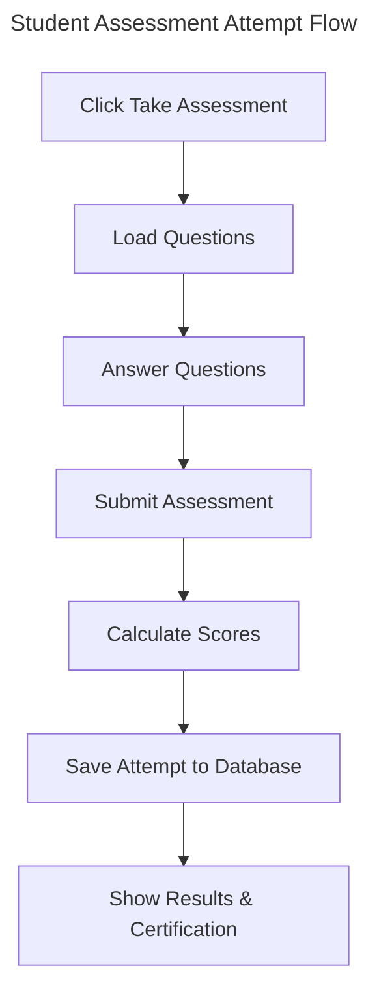

1. Click the **Take Assessment** button on your dashboard welcome banner (top-right) — or click **Take Assessment** in the navigation bar.
2. Read each question and select a Likert response (Strongly Disagree to Strongly Agree).
3. Use the **Question Palette** on the right to jump between questions and track answered / flagged items.
4. Click the **Finish & Submit** button when you reach the last item.
5. Confirm submission in the dialog that appears. Scores are calculated automatically.

## 4. View Certification Results

1. Scroll down to the **Your Assessment History** card on your **Dashboard**, or click **My Results** in the navigation bar.
2. Find the completed assessment attempt in the list.
3. Click the attempt row to open your detailed score report (Results view).
4. Check the **Certification Status** badge at the top of the Results page:
   - Certified (Passed) — you met the >= 65% institutional passing threshold.
   - Certification Threshold Not Met — re-take the assessment after reviewing your personalized Development Plan.

## 5. Discrepancy Log

| # | Section | Original (Incorrect) Statement | Correct Behaviour (Verified Against Code) | Source File |
|---|---------|-------------------------------|------------------------------------------|-------------|
| 1 | S2 Sign In Step 2 | Click the Sign in with Google button | Button is labelled Get Started (hero CTA) or Enter Portal (header); no Google OAuth exists | LandingView.jsx L111, L41 |
| 2 | S2 Sign In Step 3 | Select your institutional Google account from the popup window | Students enter university email + password, then receive a 6-digit OTP to their email; no Google popup | AuthView.jsx L182-L264 |
| 3 | S2 Sign In Step 4 | Wait for the application to load your dashboard | For students, Step 4 is entering and submitting the OTP; dashboard loads only after OTP verification | AuthView.jsx L267-L330 |
| 4 | S3 Take Assessment Step 2 | Click the Start button next to the assessment | There is no per-assessment Start button. Entry point is a single Take Assessment button on the dashboard welcome banner or the navbar | DashboardView.jsx L94-L106 |
| 5 | S4 View Results Step 1 | Navigate to the History section on your dashboard | No standalone History section exists. Attempt history is in the Your Assessment History card on the Dashboard, or under the Attempt History tab in My Results | DashboardView.jsx L522-L616; ResultsView.jsx tabs |

Last verified against commit/date: 2026-10-14

---

# Admin Guide

## 1. Question Moderation Workflow

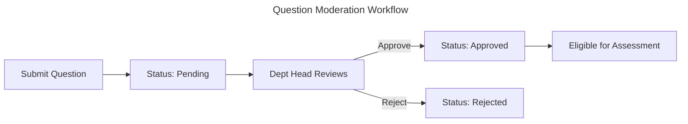

The system requires approval for new questions before students can see them.

1. Navigate to the **Question Bank** section.
2. Locate questions with the **Pending** status.
3. Review the question text and options.
4. Click **Approve** to make the question active.
5. Click **Reject** to discard the question.

## 2. Assessment Configuration

1. Navigate to the **Assessments** section.
2. Click the **Create New Assessment** button.
3. Enter a title and select a department.
4. Set the time limit in minutes.
5. Define the number of questions per competency.
6. Click **Save** to create the assessment.

## 3. Seed Data Operation

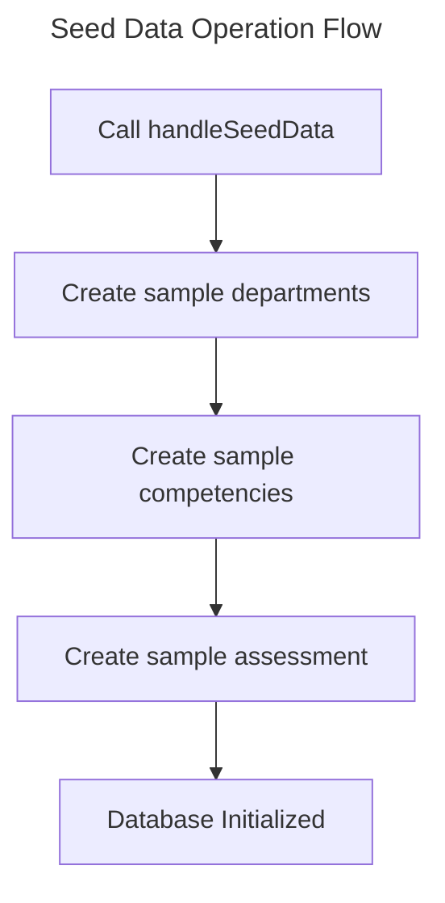

The application includes a utility to initialize the database with baseline data. This action creates sample departments, competencies, and an assessment.

1. Open the browser developer console.
2. Ensure you are signed in with the `core_team` role.
3. Type `window.handleSeedData()` and press Enter.
4. Refresh the page to see the new data.

## 4. Discrepancy Log

* None.

Last verified against commit/date: 2026-07-24

---

# Troubleshooting Reference

## 1. Sign-in Issues  

**Symptom:** The Google sign-in popup does not appear.

* Check if your browser blocks popups for the application URL.
* Allow popups for the site in your browser settings.
* Verify the Firebase Authentication domain settings in the Google Cloud Console.

## 2. Permission Errors

**Symptom:** The application denies access to a specific screen or action.

* Confirm the user profile exists in the `users` collection.
* Verify the user role matches the required role for the action.
* Note that role checks are currently UI-only; verify `firestore.rules` if backend permission errors occur.

## 3. UI Rendering Issues

**Symptom:** The application displays the generic Error Boundary fallback screen.

* Open the browser developer console.
* Check for runtime JavaScript errors.
* Check the Firestore `logs` collection for recorded `ERROR_LOG` entries.

## 4. Data Loading Issues

**Symptom:** The dashboard appears blank or assessment questions do not load.

* Ensure the question approval status is set to `approved`.
* Verify the questions map correctly to the active competencies.
* Check the browser console for Firestore read failures.

## 5. Discrepancy Log

* None.

Last verified against commit/date: 2026-07-24

---

# Glossary

## 1. Terms A-Z

* **attempt**: A single instance of a student taking an assessment, tracking their answers, scores, and certification status.
* **bootstrap admin email**: A specific, pre-configured email address that automatically receives the `core_team` role upon first sign-in.
* **certification**: A record issued to a student who successfully meets the minimum score requirement of an assessment.
* **competency**: A specific skill area being evaluated, which forms part of a larger assessment.
* **core_team**: An administrative user role with full management visibility and access to bootstrap administrative functions.
* **dept_head**: An administrative user role with management view access and participation in question workflows for their department.
* **Firestore listener**: A real-time data subscription to a Firestore database collection or document.
* **seed data**: Pre-defined baseline data (such as sample departments, competencies, and an assessment) generated to initialize the system.
* **student**: A standard user role that can take assessments and view personal attempt history.
* **system_admin**: A reserved role for global system administration.

## 2. Discrepancy Log

* None.

Last verified against commit/date: 2026-07-24

---

# Project Overview

## 1. Introduction

The Manav Rachna ICCF Portal is a web application. ICCF stands for Institutional Competency Certification Framework. The portal evaluates students on specific skills. We call a specific skill area a competency. The system records the performance of the student. The system issues a certification if the student passes the assessment. 

## 2. Core Capabilities

The portal has several main functions:

* The system authenticates users with Google accounts.
* The system shows different screens based on the role of the user.
* Students take assessments that test specific competencies.
* The system calculates a score for each assessment attempt.
* An attempt is a single instance of a student taking an assessment.
* The system stores data in a database.
* Administrators can manage questions and configure assessments.

## 3. User Roles Summary

The system supports four distinct user roles:

* **Student:** A student takes assessments. A student can view their past attempt history.
* **Dept_head:** A department head manages operations for their department. A department head reviews questions.
* **Core_team:** A core team member has full management access. A core team member can perform system setup tasks.
* **System_admin:** The system administrator role exists in the code. The system does not currently use this role for any functions.

## 4. Discrepancy Log

* None.

Last verified against commit/date: 2026-07-24

---

# Developer Setup Guide

## 1. Prerequisites

You need Node.js version 20 or higher. You need npm version 9 or higher. You need a Firebase project with Authentication and Firestore enabled.

## 2. Installation

1. Clone the repository to your local machine.
2. Open a terminal in the project root directory.
3. Run `npm install` to download dependencies.

## 3. Environment Variables

Create a `.env.local` file in the project root. Add your Gemini API key:

`VITE_GEMINI_API_KEY=your_key_here`

> [!WARNING]
> Vite embeds this key into the client bundle. You must restrict the key in the Google Cloud Console.

## 4. Firebase Configuration

The application reads configuration from `firebase-applet-config.json`. 

1. Create a Firebase project in the Firebase Console.
2. Enable the Google Authentication provider.
3. Create a Firestore database.
4. Copy your project configuration object.
5. Replace the contents of `firebase-applet-config.json` with your configuration.

## 5. Start Development Server

Run the development server command:

`npm run dev`

The server runs on host `0.0.0.0` and port `3000` by default.

## 6. Running Tests and Mock Firebase Mode

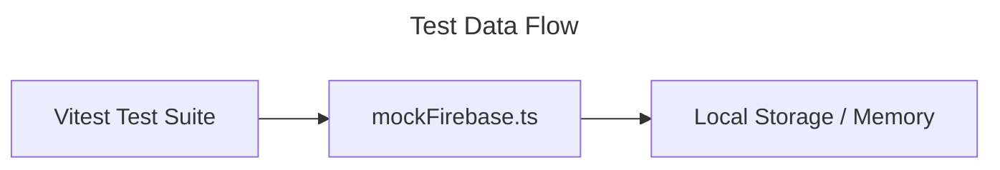

The repository uses Vitest for testing. Run the tests using the command:

`npm run test`

The test suite uses `mockFirebase.ts` instead of the live database. This mock file simulates Firebase Authentication and Firestore locally. It relies on browser local storage to maintain state during tests.

## 7. Scripts Reference

* `npm run dev`: Starts the Vite development server.
* `npm run build`: Compiles the application for production.
* `npm run preview`: Serves the compiled production build locally.
* `npm run clean`: Deletes the `dist/` directory.
* `npm run lint`: Runs the TypeScript compiler to check types.
* `npm run test`: Executes the Vitest test suite.

## 8. Discrepancy Log

* The README mentions `GEMINI_API_KEY`, but the application actually expects `VITE_GEMINI_API_KEY` to inject it successfully via Vite.
* The original README did not list the `npm run test` script, though it exists in `package.json`.

Last verified against commit/date: 2026-07-24

---

# Architecture Guide

## 1. System Architecture

The portal is a static frontend application. It connects directly to backend services without an intermediate server. 

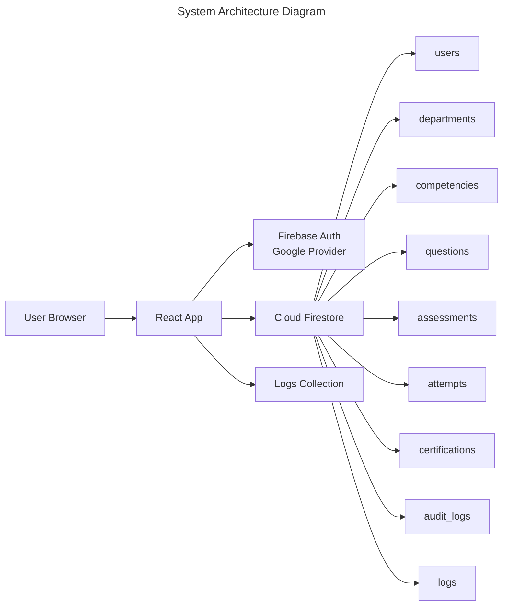

## 2. Data Flow

The application executes data operations primarily on the client.

1. The user authenticates with Google via Firebase Auth.
2. The application requests the user profile from the Firestore `users` collection.
3. The application establishes real-time Firestore listeners.
4. A Firestore listener is a real-time data subscription to a database collection or document.
5. The application evaluates assessment attempts in the browser.
6. The application writes scores directly to Firestore. 1
7. The application writes operational logs to the `logs` collection.

## 3. Hosting Model

The application compiles into static HTML, CSS, and JavaScript files. You can host these files on any static file server. The database and authentication services run entirely within Google Cloud infrastructure.

## 4. Discrepancy Log

* None.

Last verified against commit/date: 2026-07-24

---

# Data Model Reference

## 1. Collections Overview

The application uses Cloud Firestore as its primary database. It stores data across several root-level collections.

## 2. Entity Relationships (ERD)

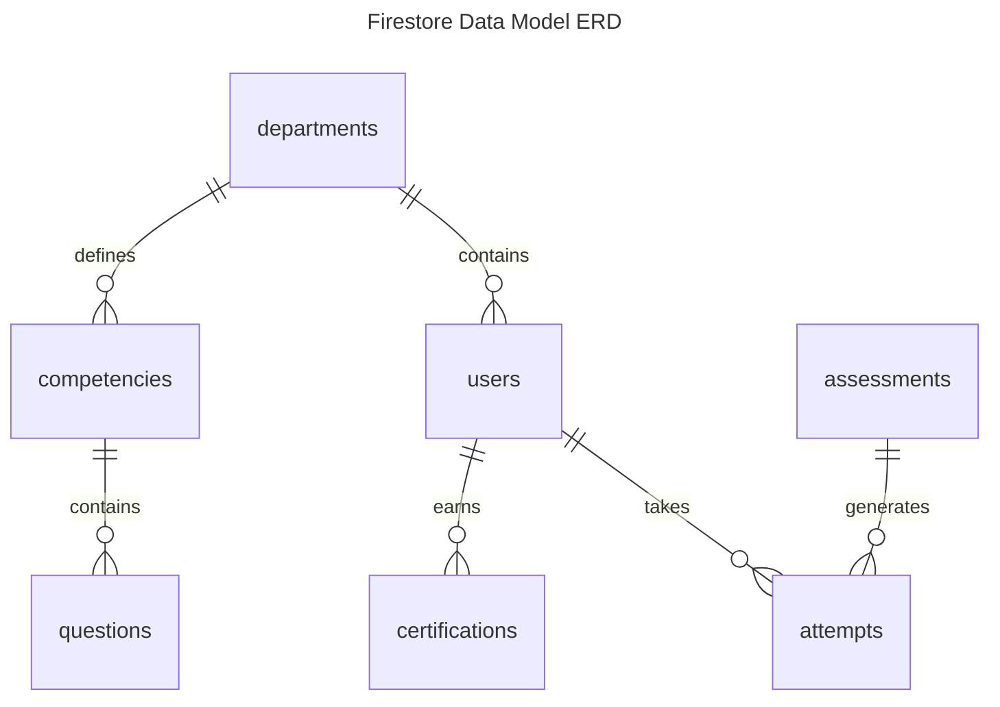

## 3. Collection Definitions

* **`users`**
  * Defines user identity and role assignment.
  * Fields: `uid`, `email`, `role`, `department`, `year`, `name`.
* **`departments`**
  * Defines university departments for data segmentation.
  * Fields: `id`, `name`, `competencyIds`.
* **`competencies`**
  * Defines a specific skill area being evaluated.
  * Fields: `id`, `departmentId`, `name`, `description`, `minimumScore`.
* **`questions`**
  * Defines assessment questions and approval workflow status.
  * Fields: `id`, `competencyId`, `text`, `options`, `correctOption`, `difficulty`, `createdBy`, `approvalStatus`.
* **`assessments`**
  * Defines the rules and limits for student testing.
  * Fields: `id`, `name`, `departmentId`, `competencyDistribution`, `timeLimit`, `active`, `scheduledAt`.
* **`attempts`**
  * Defines a single instance of a student taking an assessment.
  * Fields: `id`, `userId`, `assessmentId`, `startTime`, `endTime`, `ipAddress`, `deviceMetadata`, `answers`, `skillScores`, `overallScore`, `certificationStatus`, `timestamp`.
* **`certifications`**
  * Defines a record issued to a student who successfully meets the minimum score requirement of an assessment.
  * Fields: `id`, `studentId`, `departmentId`, `overallScore`, `competencyScores`, `issuedAt`.
* **`audit_logs`**
  * Stores immutable security records.
  * Fields: `id`, `userId`, `action`, `timestamp`, `metadata`.

## 4. Discrepancy Log

* The schema blueprint lists `timeLimit` as an integer on `assessments`, but `types.ts` defines it as a number in minutes. Both represent numerical values, but types in TypeScript and JSON schema differ slightly.

Last verified against commit/date: 2026-07-24

---

# Authentication Flow

## 1. Google Sign-in Process

The portal delegates authentication to Google. 

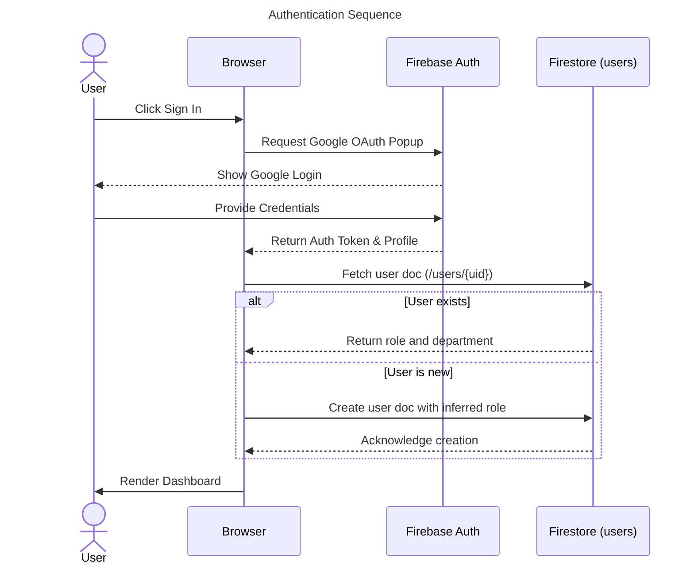

## 2. Profile Creation

The application checks the database for an existing user record after a successful Google sign-in. If the record does not exist, the application creates a new profile. 

The application checks the user email against the bootstrap admin email during profile creation. The application assigns the `core_team` role if the email matches. The application assigns the `student` role by default for all other emails.

## 3. Session Management

The application uses a Firebase Auth state listener to manage the session. The listener detects sign-in and sign-out events automatically. The application updates the user interface immediately when the session state changes.

## 4. Discrepancy Log

* None.

Last verified against commit/date: 2026-07-24

---

# Roles and Permissions Guide

## 1. Role Definitions

The system defines four distinct user roles.

* **Student:** A standard user role that can take assessments and view personal attempt history.
* **Dept_head:** An administrative user role with management view access and participation in question workflows for their department.
* **Core_team:** An administrative user role with full management visibility and access to bootstrap administrative functions.
* **System_admin:** A reserved role for global system administration.

## 2. UI Capabilities

The application shows or hides screens based on the role of the signed-in user.

* The application shows the assessment dashboard and attempt history to students.
* The application shows question moderation tools to the `dept_head` role.
* The application shows seed data operations and global assessment controls to the `core_team` role.

> [!WARNING]
> Role checks are currently UI-only. The backend does not enforce these checks.

## 3. Firestore Enforcements

The application relies on `firestore.rules` for database security. 

The current rules allow all reads and writes globally. The database does not restrict actions based on user roles.

## 4. Bootstrap Admin Security Risk

The application grants the `core_team` role to a specific, hardcoded email address upon first sign-in. This address is the bootstrap admin email.

> [!CAUTION]
> The hardcoded email check exposes the application to security risks. A compromised email account grants full administrative access automatically.

## 5. Discrepancy Log

* The original README states that role behavior is enforced in Firestore rules. The actual `firestore.rules` file contains `allow read, write: if true;`, which provides zero enforcement.

Last verified against commit/date: 2026-07-24

---

# Assessment Scoring Reference

## 1. Scoring Logic Overview

The application evaluates attempts via a deterministic psychometric scoring engine. It calculates normalized percentage scores for each competency (10 items each), derives a weighted composite score across all 15 competencies (150 items total), and determines official certification eligibility using an institutional passing threshold of **65.00%**.

## 2. Per-competency Calculation & Normalization

For each competency containing 10 Likert items (rated 1 to 5), the obtained raw score ranges from 10 to 50 points. The percentage score is normalized using the standard formula from the *Skill Framework Questionnaire Master Copy*:

$$\text{Skill Percentage} = \frac{\text{Obtained Raw Score} - 10}{40} \times 100$$

Performance is mapped to five official competency levels, marks, and behavioral descriptors:
* **Level 5 – Excellent (Highly Developed):** 85% to 100% (Marks: 4)
* **Level 4 – Strong:** 70% to 84% (Marks: 3)
* **Level 3 – Developing:** 55% to 69% (Marks: 2) — *Pass & Certification eligibility requires $\ge 65.00\%$*
* **Level 2 – Needs Improvement:** 40% to 54% (Marks: 1)
* **Level 1 – Critical Intervention Required:** Below 40% (Marks: 0)

## 3. Likert-scale Reverse Scoring

For reverse-keyed items (designed to control response bias), the score is inverted automatically using the formula:
$$\text{Revised Score} = 6 - \text{Original Response}$$

## 4. Composite Score Calculation

Across the complete 15-competency assessment (150 questions), the total raw points range between 150 (minimum) and 750 (maximum). The composite percentage is calculated as:

$$\text{Composite Score \%} = \frac{\text{Total Raw Points} - 150}{600} \times 100$$

## 5. Certification Thresholds

The application grants official institutional certification and issues a tamper-evident digital certificate with a verifiable QR code if the student achieves a composite score of **65.00% or higher** (previously 55.00%). Attempt scores strictly below 65.00% receive a 'Needs Improvement' status and a personalized development roadmap for reassessment.

## 6. AI Service Integration for Text Answers

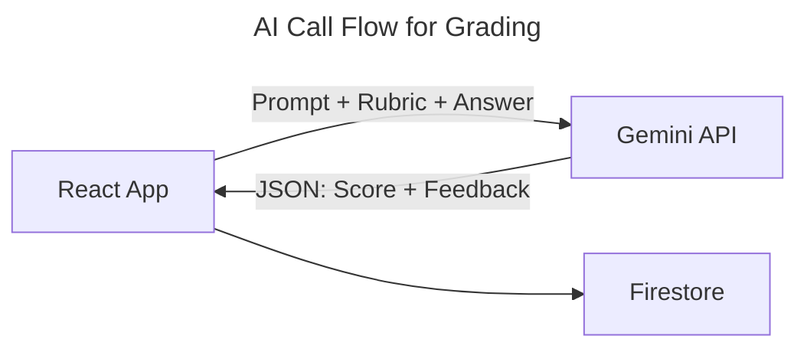

The application uses the Gemini API to grade text-based answers. The application sends the question, rubric, and student answer to the API. The API returns a JSON object containing a numeric score and text feedback.

## 7. Discrepancy Log

* The original README claims the application does not rely on Gemini API calls directly. However, `src/lib/aiService.ts` explicitly calls the Gemini API to grade text answers.

Last verified against commit/date: 2026-07-24

---

# Codebase Reference

## 1. Directory Structure

The `src/` directory contains all frontend code for the application.

* `components/`: Contains reusable React UI components.
* `lib/`: Contains utility functions and business logic modules.

## 2. File Responsibilities

* `main.tsx`: The entry point for the React application. It wraps the app in the global error boundary.
* `App.tsx`: The primary application container. It handles all routing, session state, and major UI screens.
* `firebase.ts`: Initializes the Firebase application instance. It exports the authentication and database clients.
* `types.ts`: Defines TypeScript interfaces and types for the domain model.
* `index.css`: Provides global CSS styles.
* `mockFirebase.ts`: Provides a local memory mock of Firebase for the test suite.
* `components/ErrorBoundary.tsx`: Catches unhandled React rendering errors. It displays a fallback user interface and logs the error.
* `lib/logger.ts`: Provides a structured logging utility. It writes events to the Firestore `logs` collection.
* `lib/utils.ts`: Contains generic helper functions for the application.
* `lib/scoring.ts`: Contains the logic to evaluate student answers and calculate scores.
* `lib/aiService.ts`: Manages communication with the Gemini API for text answer grading.
* `lib/likertBank.ts`: Defines the bank of Likert-scale questions and associated labels.

## 3. Module Dependencies

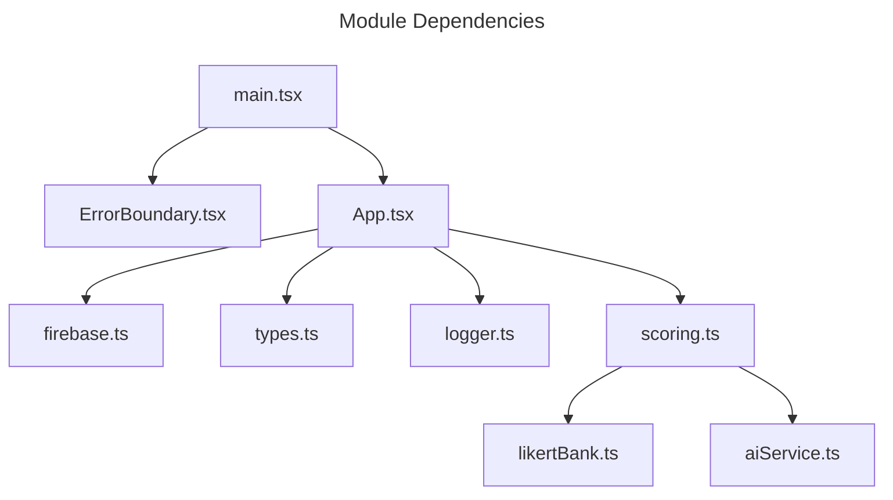

## 4. Discrepancy Log

* The README implies `App.tsx` handles "routing-by-state". It is a massive file (~281KB) that effectively acts as a monolithic container for all screens and components.

Last verified against commit/date: 2026-07-24

---

# Maintenance Scripts Reference

## 1. Overview of Scripts

The repository root contains several Node.js scripts. These scripts perform direct operations on the Firestore database. You run these scripts directly using Node.js rather than through npm. You must configure your local environment with administrative credentials before running them.

## 2. Validation and Seeding Scripts

* **`audit_db.js`**: Analyzes the database and reports inconsistencies.
* **`check_db.js`**: Verifies the basic connectivity and schema structure of the database.
* **`fix_db.js`**: Attempts to automatically repair known data inconsistencies identified by the audit script.
* **`seed-positive-attempts.js`**: Generates mock successful assessment attempts to populate dashboards for testing.

## 3. Destructive Scripts

> [!WARNING]
> Destructive scripts alter or remove production data permanently. Exercise extreme caution when executing these scripts against a live database.

* **`delete-attempt.js`**: Hard-deletes a specific student attempt record from the database. This script removes the attempt document entirely, bypassing soft-delete or archiving mechanisms.

## 4. Discrepancy Log

* None.

Last verified against commit/date: 2026-07-24

---

# Discrepancy Log

## 1. Code vs README Discrepancies

The original project README contains several statements that contradict the actual source code.

* **Security Rules:** The README states that role behavior is enforced in Firestore rules. The actual `firestore.rules` file contains `allow read, write: if true;`, providing zero backend enforcement.
* **AI Integration:** The README states that current UI paths do not rely on Gemini API calls directly. The file `src/lib/aiService.ts` explicitly calls the Gemini API to grade text-based student answers.
* **Environment Variables:** The README instructs developers to use `GEMINI_API_KEY`. The `vite.config.ts` actually expects `VITE_GEMINI_API_KEY` for successful injection into the client bundle.
* **Test Scripts:** The README omits testing commands from the "Available Scripts" section. The `package.json` file contains a valid `test` script using Vitest (`npm run test`).
* **Audit Logging:** The README mentions an `audit_logs` collection. The `src/lib/logger.ts` utility writes all structured logs to the `logs` collection exclusively.
* **Monolithic Architecture:** The README describes `App.tsx` handling "routing-by-state". It does not mention that the file is a massive monolith (~281KB) containing the entire application interface.

## 2. Unverified Information

* The `types.ts` file defines a `system_admin` role. The codebase does not appear to implement any specific behaviors or interfaces for this role yet.
* The `firebase-blueprint.json` schema blueprint lists `timeLimit` as an integer on `assessments`. The `types.ts` definitions use a standard number type.

Last verified against commit/date: 2026-07-24

---

# Deployment Guide

## 1. Build Procedure

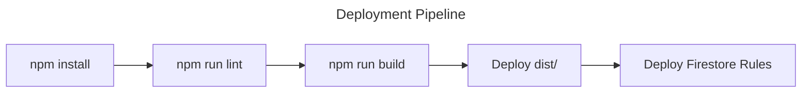

You must compile the application into static assets before deployment.

1. Run `npm install` to ensure all dependencies exist.
2. Run `npm run lint` to verify TypeScript types.
3. Run `npm run build` to compile the application.
4. Verify the output exists in the `dist/` directory.

## 2. Deployment Procedure

The `dist/` directory contains static files. You can deploy this directory to any static file hosting service. Common options include Firebase Hosting, Vercel, or Netlify.

Follow the specific instructions for your chosen hosting provider to upload the `dist/` folder.

## 3. Firestore Rules Deployment

You must deploy the Firestore security rules to protect your database. 

1. Install the Firebase CLI.
2. Authenticate the CLI with your Google account.
3. Run `firebase deploy --only firestore:rules` from the project root.

## 4. Discrepancy Log

* None.

Last verified against commit/date: 2026-07-24

---

# Logging and Monitoring Reference

## 1. Log Categories

The `logger.ts` utility categorizes events into six distinct types.

* `AUTH_LOG`: Records sign-in attempts and session changes.
* `ASSESSMENT_LOG`: Records assessment starts, submissions, and evaluation results.
* `DATABASE_LOG`: Records general database read and write operations.
* `SECURITY_LOG`: Records authorization failures and permission errors.
* `ADMIN_ACTION_LOG`: Records administrative operations like question approval.
* `ERROR_LOG`: Records unhandled exceptions and system failures.

## 2. Storage Location

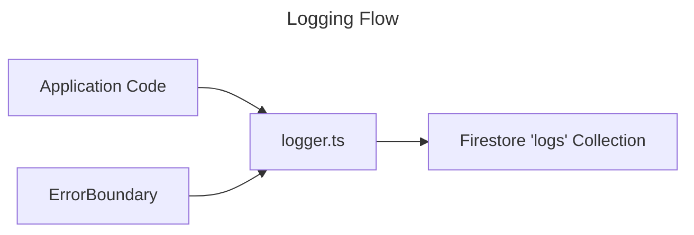

The application writes all structured logs to the `logs` collection in Firestore. Each log entry includes a server timestamp, the user ID, the category, and a metadata payload.

## 3. Error Boundary Behavior

The `ErrorBoundary` component wraps the entire React application tree. It catches JavaScript errors anywhere in the child component tree. It logs the error details using the `logger.ts` utility. It displays a fail-safe fallback user interface to prevent a blank screen.

## 4. Discrepancy Log

* The README mentions an `audit_logs` collection. The `logger.ts` utility only writes to the `logs` collection.

Last verified against commit/date: 2026-07-24

---

# Security Reference

> [!WARNING]
> Missing Server-Side Enforcement. The current `firestore.rules` file allows global read and write access (`allow read, write: if true;`). The database currently provides zero access control or role enforcement.

## 1. Security Rules Overview

The application relies on Cloud Firestore security rules to protect data. The current configuration does not validate roles. The current configuration does not protect sensitive collections from unauthorized modification.

## 2. Bootstrap Admin Caution

> [!CAUTION]
> The application hardcodes a specific email address in the source code. The application grants the `core_team` role to this email address automatically.

You must replace the hardcoded email check with a secure role assignment workflow before production deployment.

## 3. Environment Variables Warning

## 4. Hardening Recommendations

1. Write strict Firestore rules that validate user roles.
2. Remove the hardcoded bootstrap admin email from the codebase.
3. Manage administrative roles through a backend service or custom claims.
4. Implement data validation rules to prevent score manipulation.

## 5. Discrepancy Log

* The README claims that Firestore rules implement server-side enforcement. The `firestore.rules` file actually allows all operations globally.

Last verified against commit/date: 2026-07-24

---

